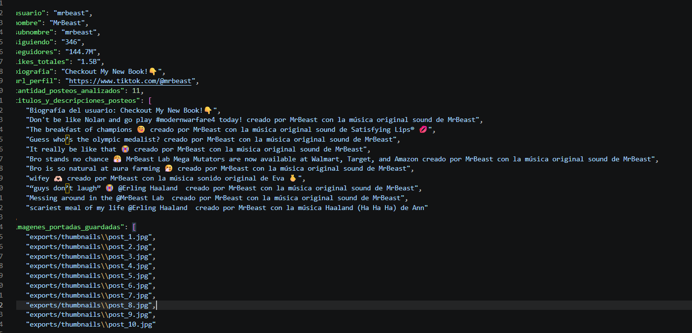
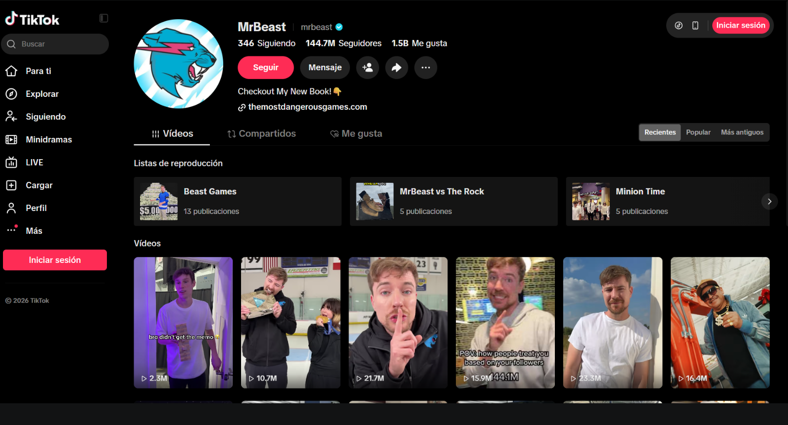

# TikTok Profile Scraper & Multimodal Big Five Personality Analysis

Este proyecto es un scraper automatizado y herramienta de análisis psicológico multimodal desarrollado en Python. Permite extraer métricas, biografía, descripciones de publicaciones, capturas de pantalla y las portadas/miniaturas de los últimos videos de cuentas de TikTok utilizando Selenium con selenium-stealth para evadir restricciones antibot. 

Posteriormente, se integra con la inteligencia artificial de Google Gemini (google-genai con el modelo Gemini 3.8 Flash) para realizar un perfilamiento psicológico multimodal basado en el modelo de los Cinco Grandes (Big Five), evaluando simultáneamente los textos de los posteos y el contenido visual de las imágenes capturadas.

---

## Características Principales

- Scraping Antidetect: Navegación automatizada en Chrome parcheada con selenium-stealth` para evitar bloqueos por Captcha y detección de bots.
- Análisis Multimodal (Texto + Imagen): Gemini 3.8 Flash procesa el lenguaje conductual de los textos y analiza visualmente la estética, contexto y expresiones de los videos.
- Resiliencia ante Límites de Tasa (Rate Limits): Sistema de reintentos con *exponential backoff* para manejar errores 503 UNAVAILABLE en la API de Gemini.
- Exportación Multiformato: Genera datos estructurados en JSON, una tabla formateada para Excel en CSV y capturas/miniaturas locales en PNG/JPG.

---

## Tecnologías Utilizadas

- Python 3.x: Lenguaje de programación base.
- Selenium & selenium-stealth: Automatización e interacción emulada de navegador web.
- Google GenAI SDK (google-genai): Conexión con el modelo multimodal Gemini 3.8 Flash.
- Pillow (PIL) & Requests: Procesamiento y descarga automatizada de imágenes.
- Pandas: Procesamiento de datos y exportación tabular.
- python-dotenv: Manejo seguro de llaves de API mediante variables de entorno (.env).

---

## Estructura del Proyecto
MiScraperTikTok/
│
├── exports/
│   ├── thumbnails/             
│   │   ├── post_1.jpg
│   │   └── ...
│   ├── mrbeast_profile.csv     
│   ├── mrbeast_profile.json    
│   └── mrbeast_profile.png    
│
├── app/
│   └── scraper.py              
│
├── .env                        
├── .gitignore
├── README.md
└── requirements.txt            #

---

## Instalación y Configuración
1. Clonar el repositorio

git clone https://github.com/xaandrade/MiScraperTikTok.git

cd MiScraperTikTok

2. Instalar dependencias
Asegúrate de instalar todos los paquetes requeridos listados en requirements.txt:

pip install -r requirements.txt

3. Configurar la clave de API
Crea un archivo .env en la raíz del proyecto y agrega tu clave de Google Gemini:

GEMINI_API_KEY=tu_clave_api_aqui

---
## Ejecución
Ejecuta el script principal desde tu terminal:
python app/scraper.py

Al finalizar la ejecución, la carpeta exports/ contendrá la captura de pantalla general, las portadas individuales descargadas en exports/thumbnails/ y el reporte psicológico Big Five sintetizado en los archivos mrbeast_profile.json y mrbeast_profile.csv.

---
## Resultados 
Como ejemplo se uso el usuario de tiktok de MrBeast

    "analisis_psicologico_big_five": {
        "Apertura": "78%",
        "Responsabilidad": "92%",
        "Extraversion": "88%",
        "Amabilidad": "76%",
        "Neuroticismo": "18%",
        "Justificacion": "El análisis psicocomportamental del creador revela un perfil caracterizado por una altísima Responsabilidad (92%) y Extraversión (88%). A nivel visual y textual, se evidencia una fuerte orientación al logro, planificación estratégica y disciplina comercial: la presencia recurrente de productos propios ('MrBeast Lab Mega Mutators'), menciones de venta masiva (Walmart, Target, Amazon), promoción de libros y el reconocimiento de hitos (el botón de diamante de YouTube y placas conmemorativas) denotan un enfoque hipermetódico hacia el éxito profesional. En cuanto a la Extraversión, las imágenes muestran una constante inserción en entornos gregarios, rodeado de colaboradores, atletas de élite (Erling Haaland, medallistas olímpicos) y gestos expresivos directos hacia el espectador (sonrisas amplias, guiños, contacto visual firme). La Apertura a la experiencia (78%) se manifiesta en la continua experimentación lúdica, la creación de formatos no convencionales y la rápida asimilación de la cibercultura ('aura farming', dinámicas de memes contemporáneos). La Amabilidad (76%) se proyecta a través de una dinámica grupal horizontal y cálida, uso de lenguaje afectivo e inclusivo ('wifey', 'bro', humor compartido sin hostilidad), facilitando la cohesión social. Finalmente, el Neuroticismo es marcadamente bajo (18%), proyectando gran estabilidad emocional, resiliencia ante el escrutinio masivo, autoconfianza y una notable capacidad de autorregulación emocional en cámara, incluso en situaciones de alta presión o dramatización cómica."
    }
}

